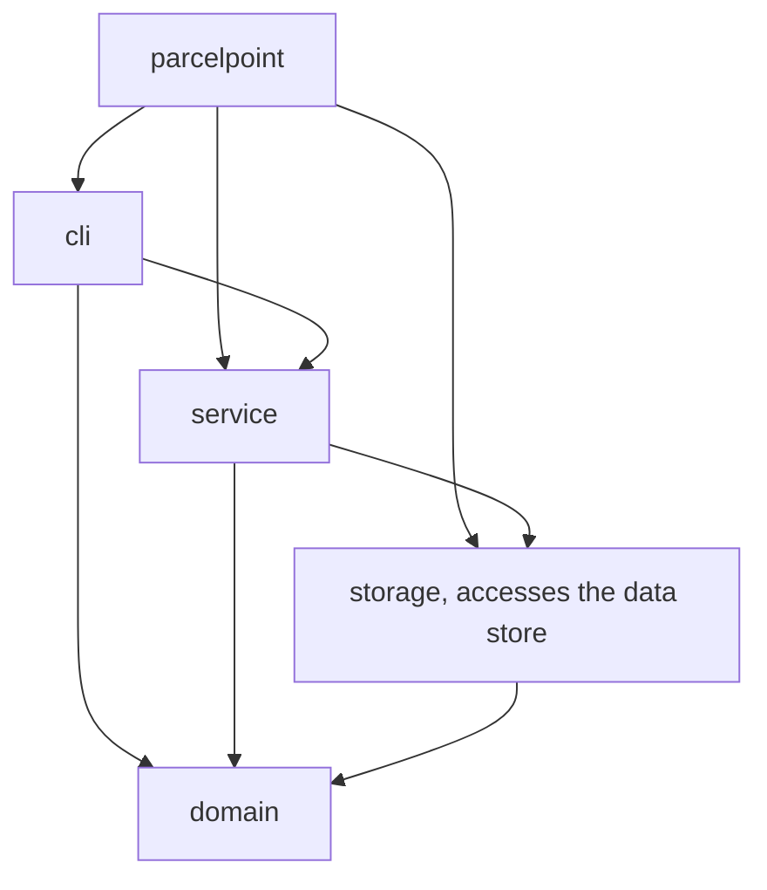
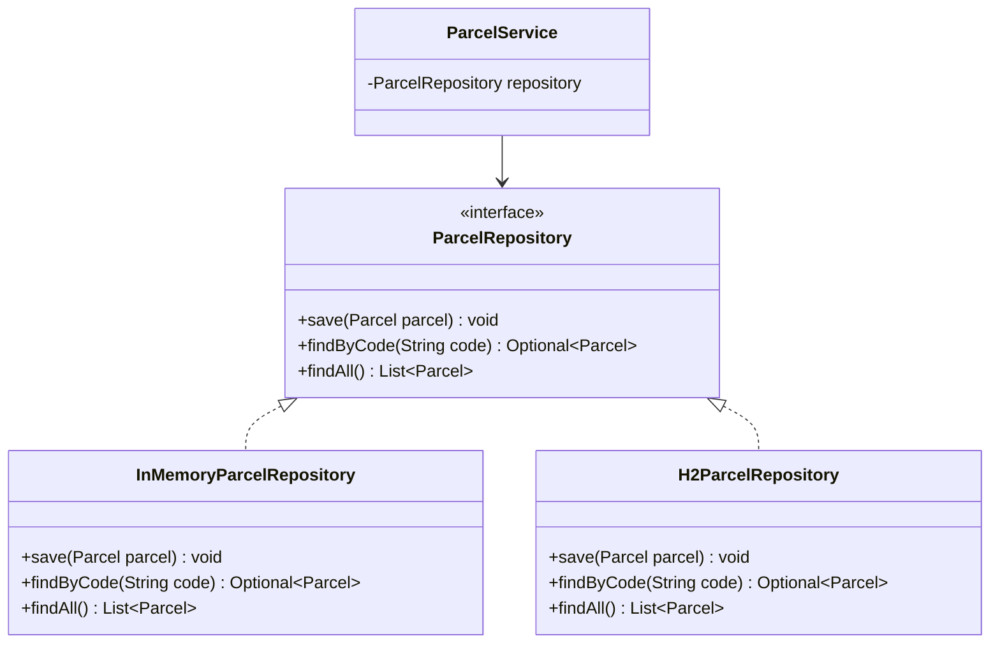
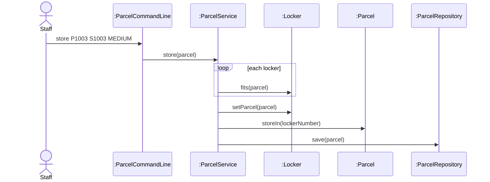

# Lab Report, Designing the Data Management Layer with H2

Repository URL: https://github.com/warawuth4/itcs382-h2-lab

## Tools

| Item | Version or name |
| --- | --- |
| JDK | OpenJDK 17.0.17 |
| Maven | 3.10.0 |
| IDE | Visual Studio Code 1.142.0 |
| AI tool and exact model, if you used one | Antigravity (Gemini 2.5 Pro) |

## Part 0. From a store in memory to H2

Commit of the starter, before any change: ce9e326

0.3 Your prediction for `staff`, written before the second run:

I predict that `staff` will output `Free lockers: 3` and show no parcels, because the previous run used `InMemoryParcelRepository`, which keeps parcels in volatile heap memory that is cleared as soon as the program terminates.

Output of the second run, for `staff` and `quit`:

```text
> staff
Free lockers: 3
> quit
```

State in one sentence where you think the parcels of the first run were kept.

The parcels of the first run were kept in volatile heap memory inside the LinkedHashMap of InMemoryParcelRepository, which was cleared when the JVM process ended.

0.5 The line of Main that you would change to keep the parcels somewhere else:

```java
ParcelRepository repository = new InMemoryParcelRepository();
```

0.6 Commit of the switch to H2: fcf8582

0.7 Output of `SELECT * FROM PARCEL;` after you stored two parcels:

```text
sql> SELECT * FROM PARCEL;
CODE  | STUDENT_ID | PARCEL_SIZE | STATUS | LOCKER_NUMBER
P1001 | S1001      | SMALL       | STORED | 1
P1002 | S1002      | LARGE       | STORED | 3
(2 rows, 9 ms)
```

0.8 Explain why ParcelPoint could not start while the H2 Shell was open, and identify the class that wrote the message `Cannot create the PARCEL table`.

ParcelPoint could not start because H2 was opened in embedded file mode by the H2 Shell process, which placed an exclusive lock on `parcelpoint.mv.db`, preventing another process from opening the database file simultaneously. The class that wrote the message `Cannot create the PARCEL table` is `H2ParcelRepository` (inside its constructor where it catches `SQLException` and throws an `IllegalStateException`).

0.9 Explain why `staff` shows no parcel while `find` shows each one, and why all three lockers look free.

`staff` shows no parcel because `H2ParcelRepository.findAll()` was not yet implemented and simply returned an empty list (`List.of()`), whereas `find` calls `findByCode()`, which was already implemented with a SQL `SELECT` query. All three lockers look free because the constructor of `ParcelService` restores locker occupancy by iterating over `repository.findAll()`; since `findAll()` returned an empty list, no lockers were populated with their stored parcels on startup.

0.11 Your findAll method:

```java
    @Override
    public List<Parcel> findAll() {
        List<Parcel> parcels = new ArrayList<>();
        String sql = "SELECT * FROM PARCEL ORDER BY CODE";
        try (Connection connection = connect();
             PreparedStatement statement = connection.prepareStatement(sql);
             ResultSet row = statement.executeQuery()) {
            while (row.next()) {
                parcels.add(toParcel(row));
            }
        } catch (SQLException e) {
            throw new IllegalStateException("Cannot read the parcels", e);
        }
        return parcels;
    }
```

Commit that adds findAll: 2b9be22

0.12 Output of `SELECT * FROM PARCEL;` after the pickup:

```text
sql> SELECT * FROM PARCEL;
CODE  | STUDENT_ID | PARCEL_SIZE | STATUS    | LOCKER_NUMBER
P1001 | S1001      | SMALL       | PICKED_UP | null
P1002 | S1002      | LARGE       | STORED    | 3
(2 rows, 11 ms)
```

0.13 Optional. Describe what `find P9999'OR'1'='1` showed while the SQL was joined from strings, and what it showed after you put the placeholder back.

While the query was joined using raw string concatenation (`"SELECT * FROM PARCEL WHERE CODE = '" + code + "'"`), typing `find P9999'OR'1'='1` triggered a SQL injection where the injected `'1'='1'` caused the WHERE clause to evaluate to true for every record, returning all rows and displaying the first parcel (`P1001, S1001, SMALL, PICKED_UP`). After restoring the `?` placeholder and using `statement.setString(1, code)`, H2 safely treated the input as a single literal string; since no parcel possessed that code, the query matched nothing and correctly output `No parcel with code P9999'OR'1'='1`.

## Part A. Model the design

A1 Complete the flowchart with one node for each package and one arrow for each dependency, from the package that uses to the package that is used. Mark the package that accesses the data store.



State whether cli depends on storage, and explain why.

No, `cli` does not depend on `storage`. The classes in `cli` (such as `ParcelCommandLine`) only import classes from `domain` and `service`. User commands communicate strictly through `ParcelService`, completely decoupling the presentation/CLI layer from the repository interface and data storage implementations.

A2 Complete the class diagram of the data management layer with ParcelService, the interface ParcelRepository with its three operations, and the two classes that implement it.



A3 Draw a sequence diagram for the command `store P1003 S1003 MEDIUM`, from the staff member to the repository. Show each message as an operation of the class that receives it.



Explain why the last lifeline is the interface ParcelRepository rather than H2ParcelRepository.

The last lifeline is the interface `ParcelRepository` because `ParcelService` adheres to the Dependency Inversion Principle and depends only on the high-level `ParcelRepository` abstraction. `ParcelService` does not know about `H2ParcelRepository`; its code only invokes the `save(Parcel)` method defined on the interface. At the level of the service design and message interactions, the recipient is the abstraction `ParcelRepository`.

## Part B. Design questions

1. Identify the files that you changed to move from the store in memory to H2, and explain why no other class had to change. Use the terms of this course.

Only `Main.java` was modified to switch from `InMemoryParcelRepository` to `H2ParcelRepository`. No other classes in `cli`, `service`, or `domain` had to change because the system follows the Dependency Inversion Principle (DIP) and the Repository design pattern. `ParcelService` depends on the `ParcelRepository` abstraction rather than a concrete data store, and `Main` serves as the composition root injecting the concrete implementation. This separation of concerns and loose coupling shields the business logic and user interface from persistence mechanism changes.

2. The PARCEL table stores the size of a parcel as SMALL, MEDIUM or LARGE rather than as 1, 2 or 3. Identify the type of connascence between ParcelSize and the table in each case, and explain which one is weaker.

Storing parcel sizes as strings (`"SMALL"`, `"MEDIUM"`, `"LARGE"`) establishes **connascence of name**, requiring both the database and the Java `ParcelSize` enumeration to agree on the symbolic names. Storing them as integers (`1`, `2`, `3`) establishes **connascence of convention**, requiring both systems to rely on an implicit encoding agreement. Connascence of name is weaker than connascence of convention because names are self-documenting and less prone to breaking if enum declarations are reordered or extended.

3. Project Phase 2 asks for a data store that needs no separate server. Explain why an embedded database such as H2 meets this rule, and describe the limit of an embedded database that Step 0.8 showed.

An embedded database such as H2 meets this requirement because the database engine executes directly inside the application's JVM process and manages files locally, without requiring any external database server daemon. However, as Step 0.8 demonstrated, a key limitation of an embedded file database is single-process exclusive file locking: only one process can hold the database file open at a time, preventing multiple concurrent processes (such as the running application and the H2 Shell) from accessing the data store simultaneously.

4. State the data store that you would choose for your Project Phase 2 team, files or an embedded database, the requirement that drives the choice, and the package that will access it.

Our Project Phase 2 team would choose an **embedded database (H2)**. The requirement driving this choice is the need for structured, persistent relational data storage with atomic transactions, consistency, and SQL querying capabilities without the complexity of managing a separate server or writing custom file serialization and parsing logic. The package that will access this data store is the `storage` package, encapsulating all SQL and JDBC details behind clean repository interfaces.

## AI usage declaration

| AI tool and exact model | Date | Purpose | Files or answers it produced or changed | How you checked its output |
| --- | --- | --- | --- | --- |
| Antigravity (Gemini 2.5 Pro) | 14 November 2026 | Assisting with verification of answer | `LAB_REPORT.md` | Compiled and verified with `mvn package`, tested CLI commands (`store`, `pickup`, `find`, `staff`), inspected the database using H2 Shell, and checked Mermaid diagram syntax. |
